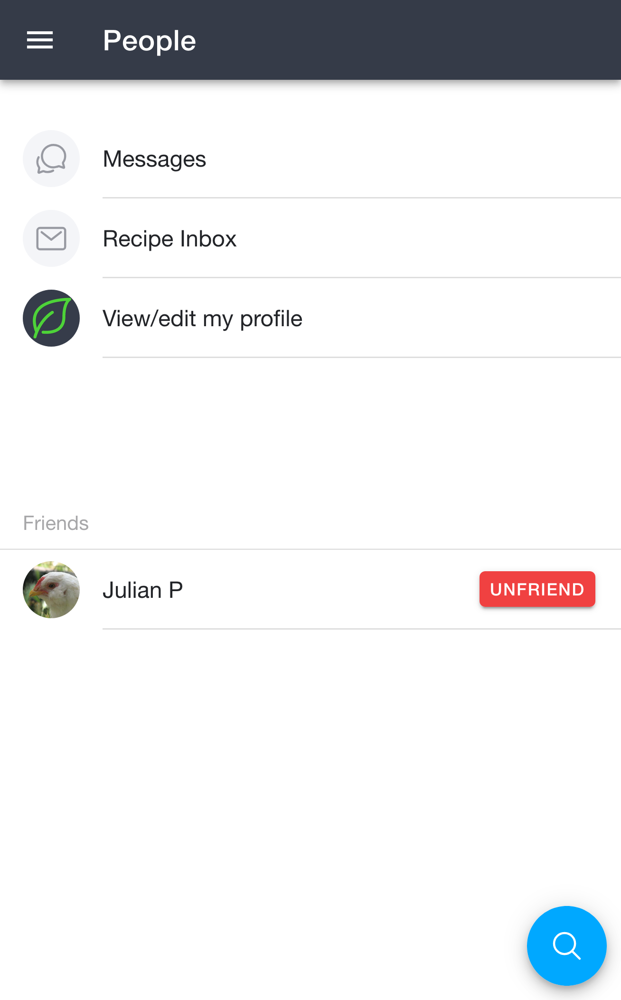
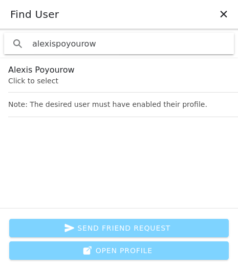
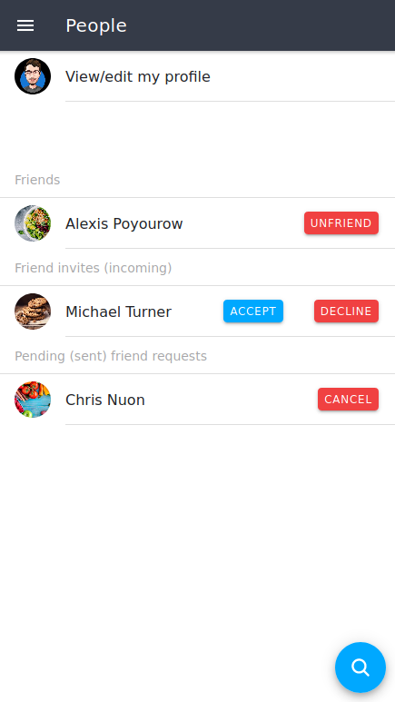
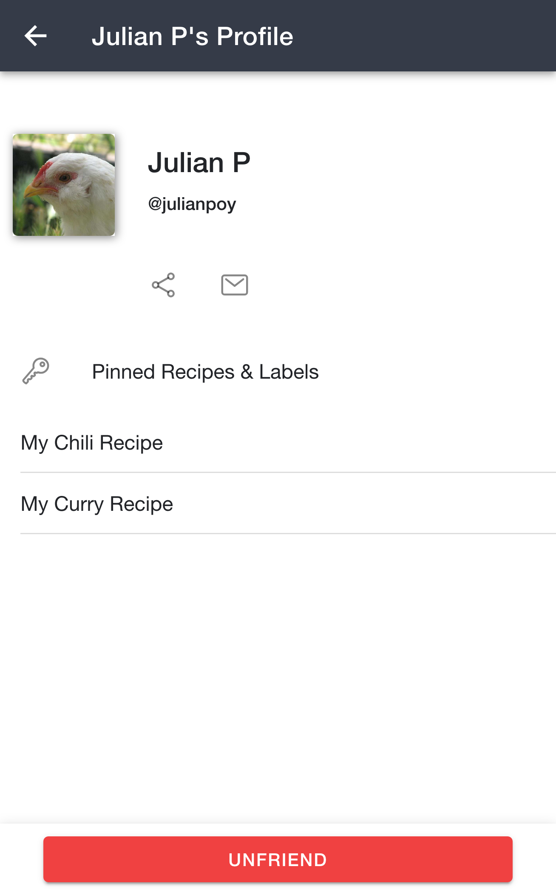

The RecipeSage people page is home to allows you to share and view content to and from your friends or family. Using the people and profile features, you can share your own recipe collection or view the recipe collections of your friends. To setup your own profile, follow the steps outlined on the [📖 your profile documentation page](./your-profile.md).

## People &amp; Profile Home

</img>

Once you set up your profile, the [📱 People](https://recipesage.com/app/people) page will allow you to access your profile and settings, add friends, and search for other RecipeSage users.
You'll also be able to share individual recipes, all recipes within a label, or even your entire recipe library with friends or the public via [📖 your profile](./your-profile.md).

From here you can jump to your **Messages**, your **Recipe Inbox** (recipes other users have sent you), or **View/edit my profile**.
Your friends, along with any incoming friend invites and pending friend requests, show up further down this page.
To access these features however, you'll need to first [📖 set up your profile](./your-profile.md).

## Finding Other Users

</img>

After you setup your profile, you can find other users profiles by clicking the search button in the bottom right corner of the [📱 People](https://recipesage.com/app/people) page.
This will bring up the dialogue shown in the image above.

This dialogue allows you to search for other users by handle or by email.
After selecting a user, you'll be able to send a friend request, or view the other person's profile.

## Friend Requests

</img>

When you [📖 send a friend request](#finding-other-users) to another person, you'll see that pending friend request listed on the [📱 People](https://recipesage.com/app/people) page.
At this point, the other user will see a friend request in their people page, and can decide to either accept/deny that invite.
Once they accept, you'll see that user listed under your "friends" section.

Likewise, you'll see friend requests from other users show up on this page and have the chance to accept or deny their invite.

At any point during the friending process, you can click the user's name to open their profile page.

## Viewing Other User's Profiles

</img>

Once you click a user on the [📱 People](https://recipesage.com/app/people) page, you'll see their profile.
Their profile shows their name and @handle at the top, along with buttons to share their profile or send them a message, and a **Pinned Recipes & Labels** section listing everything they've chosen to share.
There's also an **Unfriend** button at the bottom if you'd like to remove the friendship.

Keep in mind that a user's profile may appear differently depending on whether you're friends with that user or not.
In other words, if you're friends with the user you'll not only see public items, but friends-only items as well.

Simply click one of the listed items on their profile (if they have any) to open it.
To save a recipe from someone else's profile to your collection, open the recipe that you'd like to save and click the blue button at the bottom of the recipe details page.

## Blocking and Reporting Users

If someone sends you unwanted or offensive messages or content, you can report them, block them, or both.

Open their profile or your conversation with them, then click the options button in the top right corner. You'll see these choices:

- **Report User** asks you to explain what happened. Our team will review your report.
- **Block User** stops that person from sending you messages, sending you friend requests, or adding you to shopping lists and meal plans. Blocking also removes them from your friends, and removes you from each other's shopping lists and meal plans. They won't be told that you blocked them.

Your conversation with someone you've blocked will no longer show in your **Messages**.

Once you've blocked someone, a **Blocked Users** item appears on the [📱 People](https://recipesage.com/app/people) page. Open it to see everyone you've blocked, and click **Unblock** next to a name to unblock that person.
You can also unblock someone from their profile or from your conversation with them.

Unblocking someone doesn't bring back your friendship or any shared shopping lists and meal plans. You'll need to send a new friend request or add them again.

